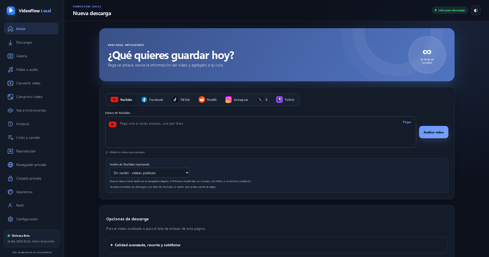
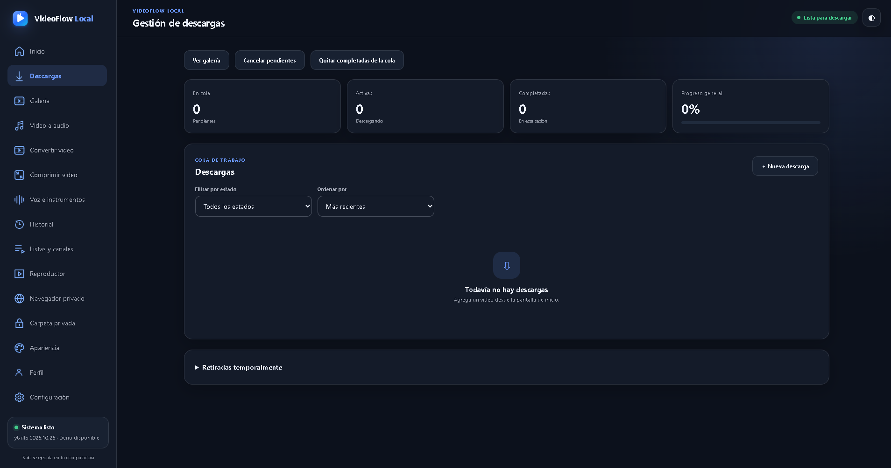
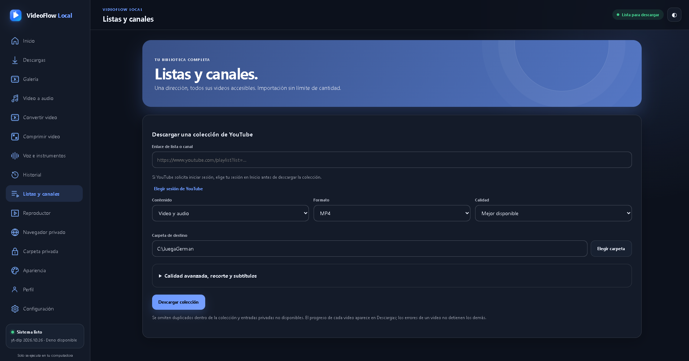
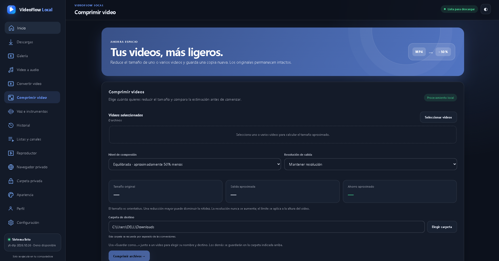
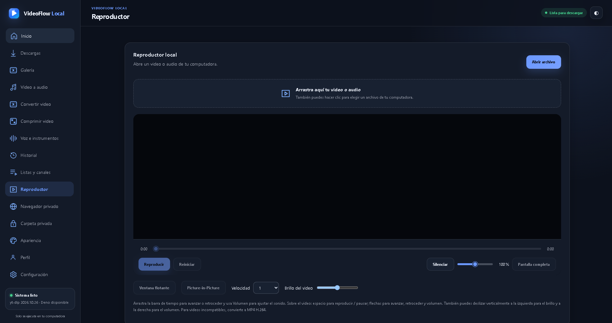

  
  <h1>VideoFlow Local</h1>
  
Descarga, convierte y reproduce video y audio en Windows.

  

    
    
  

  
<a href="https://github.com/Marco035xd/VideoFlow-Local/releases/latest"><strong>Descargar para Windows</strong></a>

  

    <a href="#capturas-de-pantalla">Capturas</a> ·
    <a href="#funciones">Funciones</a> ·
    <a href="#instalación">Instalación</a> ·
    <a href="#código-fuente">Código fuente</a> ·
    <a href="https://github.com/Marco035xd/VideoFlow-Local-Android">Android</a>
  

## Funciones

| Área | Qué puedes hacer |
| --- | --- |
| **Descargas** | Guarda videos de YouTube, Facebook, TikTok, Reddit, Instagram, X y clips de Twitch. Elige formato, resolución, pista de audio, recorte y subtítulos según el origen. |
| **Listas y canales** | Importa colecciones de YouTube y consulta el peso total aproximado antes de añadirlas a la cola. |
| **Cola, galería e historial** | Filtra los trabajos por estado, ordénalos y copia sus enlaces originales. Reanuda descargas interrumpidas, restaura registros retirados y busca por título o plataforma en la galería. |
| **Conversión y compresión** | Convierte videos a MP4, MKV, MOV, AVI o WebM. Extrae audio en MP3, M4A, WAV, FLAC u OGG Vorbis, reduce el tamaño de tus videos y separa voz e instrumentos en tu equipo. |
| **Reproductor** | Abre tus archivos locales y sigue viendo en ventana flotante o Picture-in-Picture. |
| **Personalización** | Elige temas, fondos y opacidad. Personaliza tu perfil, configura los sonidos y usa la app en español, inglés o portugués. |
| **Herramientas locales** | Protege copias de archivos en la carpeta cifrada con PIN y actualiza FFmpeg y FFprobe desde Configuración. |

## Capturas de pantalla

<table>
  <tr>
    <td width="50%" valign="top">
       
      <strong>Descargas</strong> · Estado, orden y progreso
    </td>
    <td width="50%" valign="top">
       
      <strong>Listas y canales</strong> · Colecciones de YouTube
    </td>
  </tr>
  <tr>
    <td width="50%" valign="top">
       
      <strong>Compresión</strong> · Reducción y resolución de salida
    </td>
    <td width="50%" valign="top">
       
      <strong>Reproductor</strong> · Ventana flotante y Picture-in-Picture
    </td>
  </tr>
</table>

**[Ver las 15 capturas en tamaño completo](docs/CAPTURAS.md)**

## Instalación

1. Descarga el archivo `VideoFlow-Local-…-Setup-x64.exe` de la [última publicación para Windows](https://github.com/Marco035xd/VideoFlow-Local/releases/latest).
2. Ejecuta el instalador y abre **VideoFlow Local** desde el menú Inicio.

Compatible con **Windows 10 (1809 o posterior)** y **Windows 11** de 64 bits. El instalador incluye Python, FFmpeg, FFprobe y Deno. Si falta WebView2, lo instala durante la configuración.

## Código fuente

Para ejecutar el proyecto, clona o descarga el repositorio en Windows. Ejecuta [`INSTALAR.bat`](INSTALAR.bat) y luego [`INICIAR.bat`](INICIAR.bat). El entorno usa Python 3.11 o posterior, FFmpeg, FFprobe y WebView2. El script usa WinGet para preparar las herramientas que falten, incluido Deno para mejorar la compatibilidad con YouTube.

Para compilar el instalador, instala Inno Setup 6 y ejecuta [`CREAR_INSTALADOR.ps1`](CREAR_INSTALADOR.ps1) desde PowerShell. El resultado queda en `release/`.

Consulta la [documentación de idiomas](docs/IDIOMAS.md) y los [avisos de los componentes incluidos](packaging/THIRD_PARTY_NOTICES.md).

## Proyecto

¿Encontraste un problema o tienes una idea? Abre una [incidencia](https://github.com/Marco035xd/VideoFlow-Local/issues) con los pasos y la versión de la app. El código y las APK de Android están en el [repositorio de VideoFlow Local para Android](https://github.com/Marco035xd/VideoFlow-Local-Android).

Usa VideoFlow Local para guardar contenido propio o que tengas autorización para descargar.
