# Capturas de VideoFlow Local

[Volver al README](../README.md#capturas-de-pantalla)

[Descargas](#descargas) · [Herramientas](#herramientas) · [Reproducción y personalización](#reproducción-y-personalización) · [Configuración](#configuración)

## Descargas

### Inicio

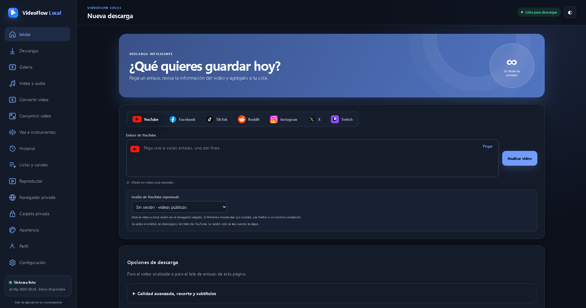

### Cola de descargas

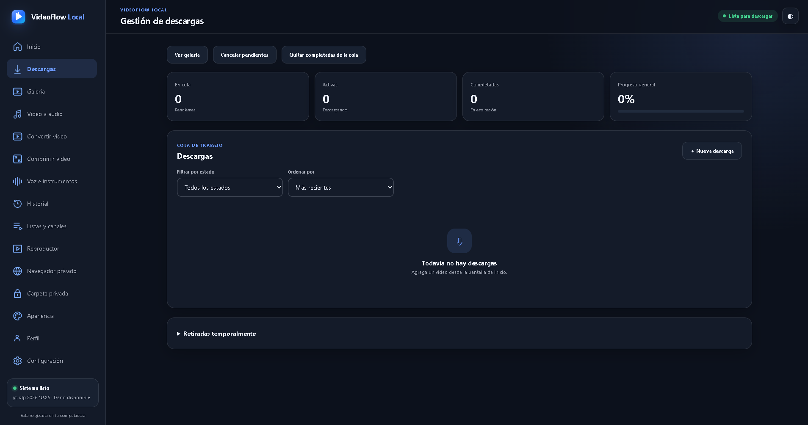

### Listas y canales

### Historial

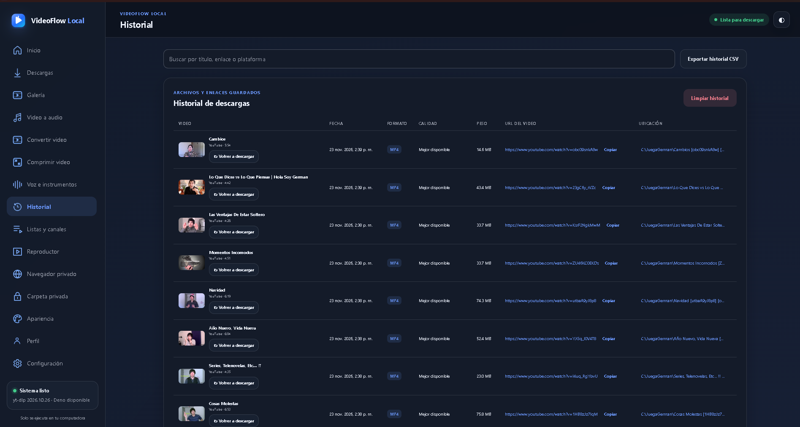

## Herramientas

### Video a audio

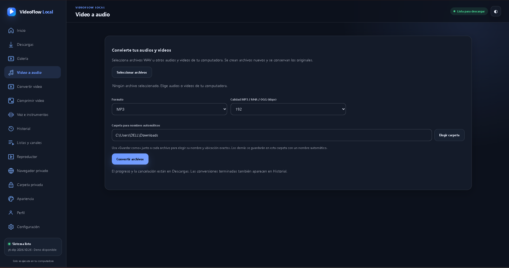

### Convertir video

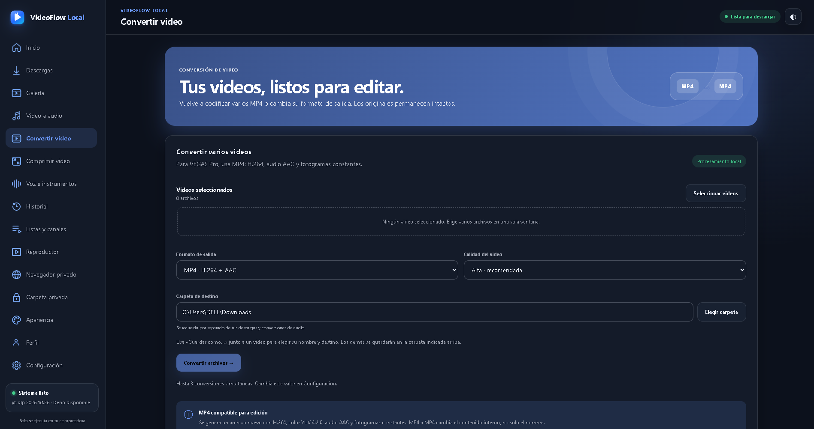

### Comprimir video

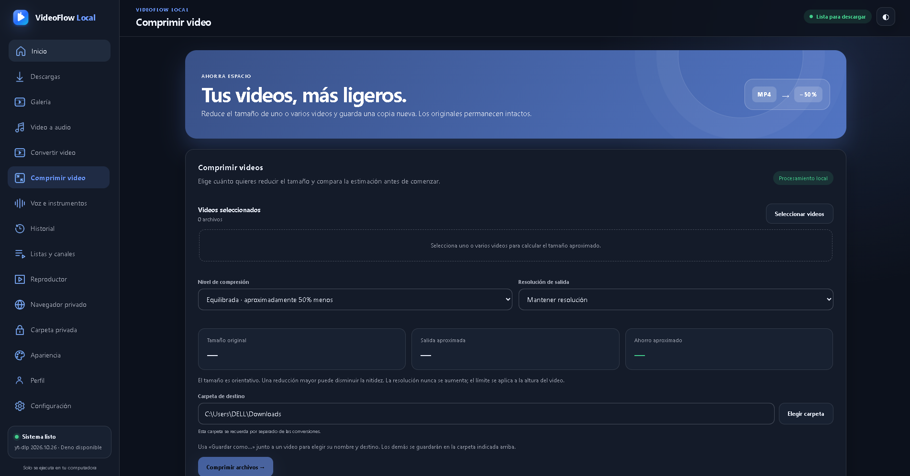

### Voz e instrumentos

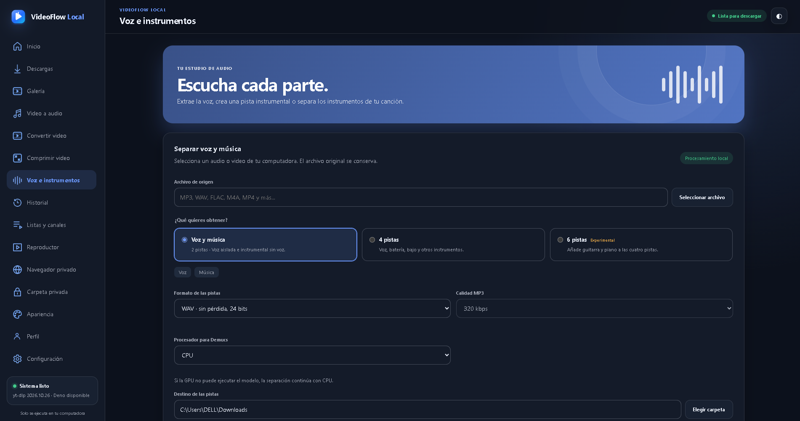

## Reproducción y personalización

### Reproductor

### Apariencia

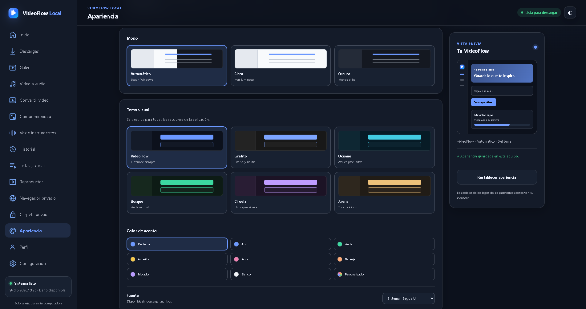

### Perfil

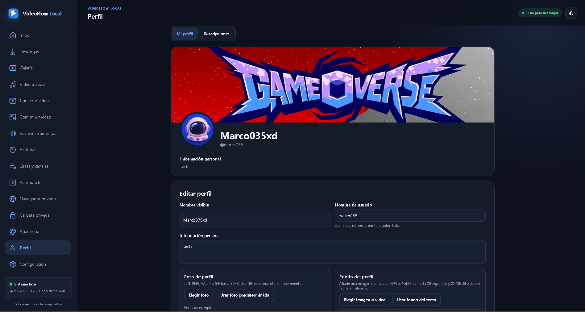

## Configuración

### Idioma

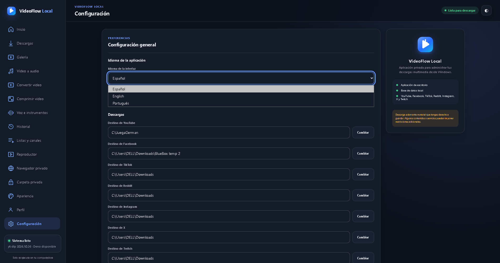

### Carpetas y concurrencia

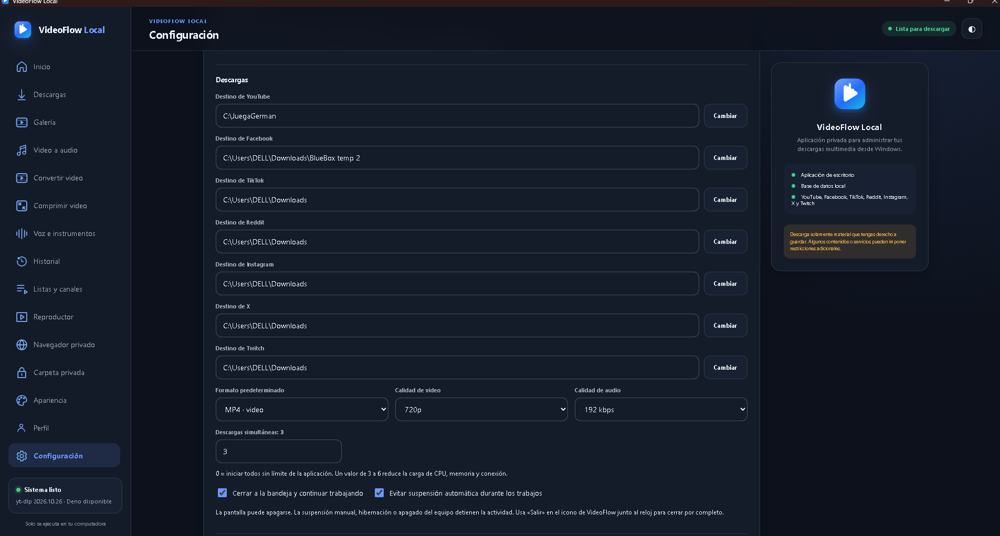

### Conservación y conexión

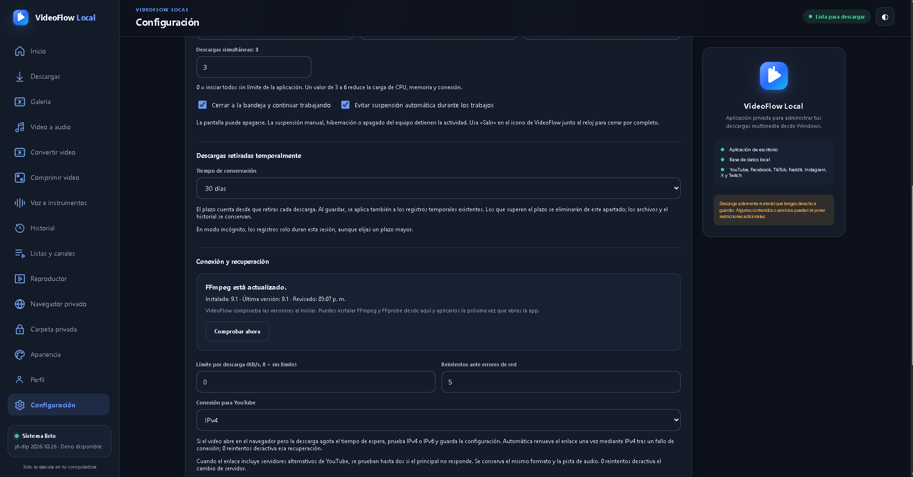

### Avisos y sonidos

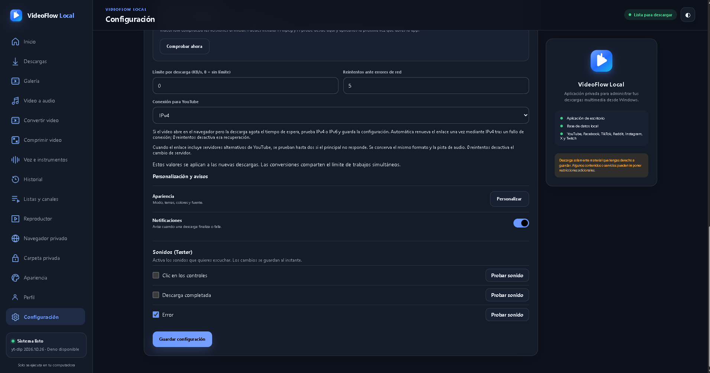
