# Recorrido visual de VideoFlow Local

Estas 11 capturas del **25 de octubre de 2026** presentan las secciones de la aplicación en el orden de su barra lateral. Cada descripción explica la función de la pantalla y el estado que se ve en la imagen.

[Volver al README](../README.md#capturas-de-pantalla)

## Índice

1. [Inicio y nueva descarga](#01-inicio-y-nueva-descarga)
2. [Gestión de descargas](#02-gestión-de-descargas)
3. [Video a audio](#03-video-a-audio)
4. [Voz e instrumentos](#04-voz-e-instrumentos)
5. [Historial](#05-historial)
6. [Listas y canales](#06-listas-y-canales)
7. [Reproductor local](#07-reproductor-local)
8. [Navegador privado](#08-navegador-privado)
9. [Carpeta privada](#09-carpeta-privada)
10. [Apariencia](#10-apariencia)
11. [Configuración](#11-configuración)

## 01. Inicio y nueva descarga

Pantalla de entrada para pegar enlaces de **YouTube, Facebook o TikTok** y preparar una descarga. La captura muestra **TikTok seleccionado**, el campo que acepta varios enlaces —uno por línea— y el acceso a opciones de calidad, recorte y subtítulos. El formulario está esperando los enlaces; todavía no se ha analizado ningún video.

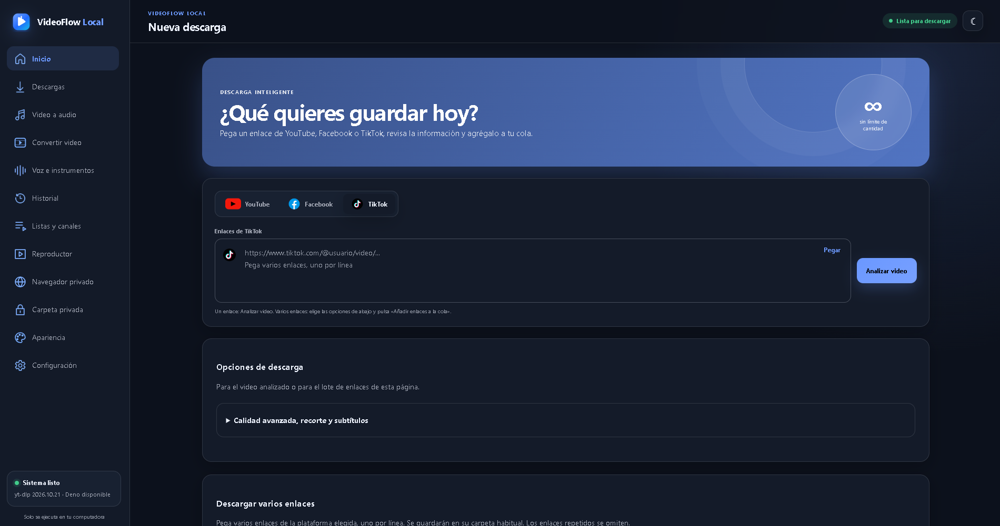

## 02. Gestión de descargas

Panel para seguir los trabajos con contadores de **pendientes, activos y completados**, además del progreso general. Incluye accesos para crear una descarga, cancelar pendientes y quitar trabajos completados de la cola. En esta captura la sesión no tiene trabajos y el progreso está en **0 %**.

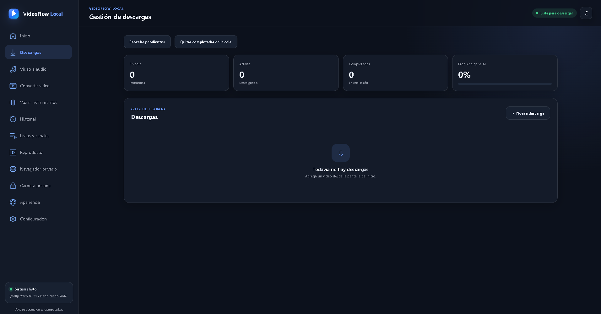

## 03. Video a audio

Herramienta para seleccionar **varios videos locales** y extraer su audio conservando los originales. Permite elegir formato, calidad y carpeta de salida; también ofrece «Guardar como» por archivo después de seleccionarlo. La vista está preparada para convertir a **MP3 a 192 kbps**, sin archivos seleccionados todavía.

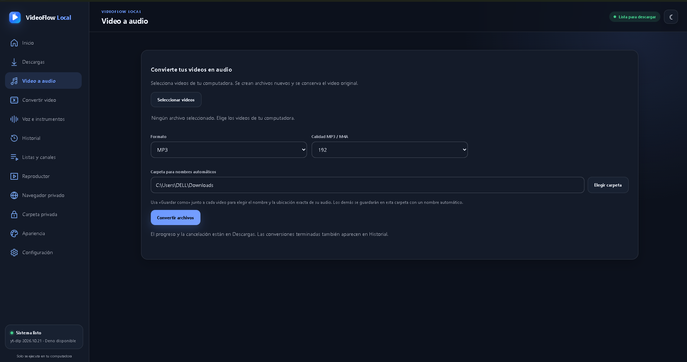

## 04. Voz e instrumentos

Sección para separar un audio o video local en **voz e instrumental, cuatro pistas o seis pistas**. La captura tiene seleccionadas **seis pistas, en modo experimental**: voz, batería, bajo, otros, guitarra y piano, con salida **WAV de 24 bits**. No hay archivo de origen cargado; el aviso indica que el modelo de este modo se descargará al iniciar el primer trabajo y se conservará para las siguientes separaciones. El procesamiento del audio se realiza en el equipo.

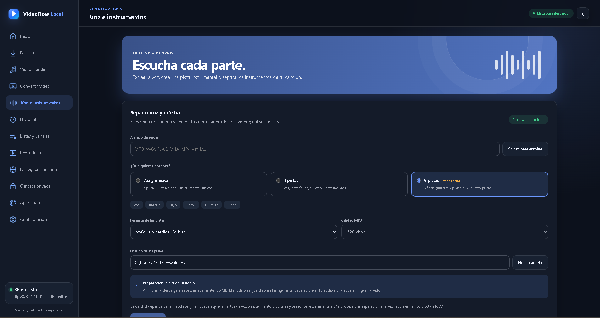

## 05. Historial

Vista de consulta de las descargas completadas y sus enlaces guardados, con **búsqueda por título, enlace o plataforma** y exportación a **CSV**. La captura muestra el historial vacío después de limpiar sus registros. El aviso de confirmación aclara que los archivos guardados permanecen intactos.

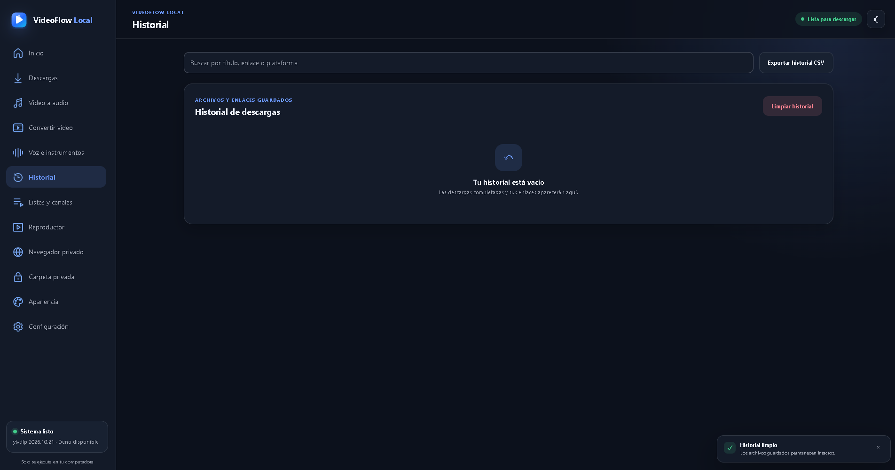

## 06. Listas y canales

Formulario para importar los videos accesibles de una **lista de reproducción o un canal de YouTube**. Permite definir contenido, formato, calidad, destino y opciones avanzadas antes de enviar la colección a Descargas. En la imagen están elegidos **video y audio, MP4 y la mejor calidad disponible**; falta introducir el enlace de la colección.

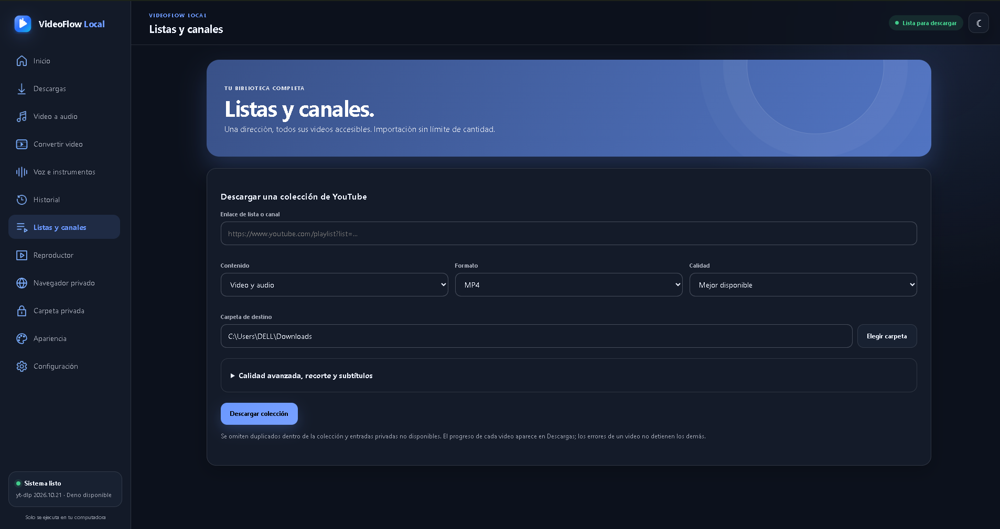

## 07. Reproductor local

Reproductor para abrir un archivo de video o audio desde el selector o **arrastrarlo al área indicada**. La pantalla reúne barra de tiempo, reproducción, reinicio, volumen, pantalla completa, ventana flotante, Picture-in-Picture, velocidad y brillo del video. La captura muestra el estado inicial, **sin archivo abierto**, por lo que los controles que requieren contenido están deshabilitados.

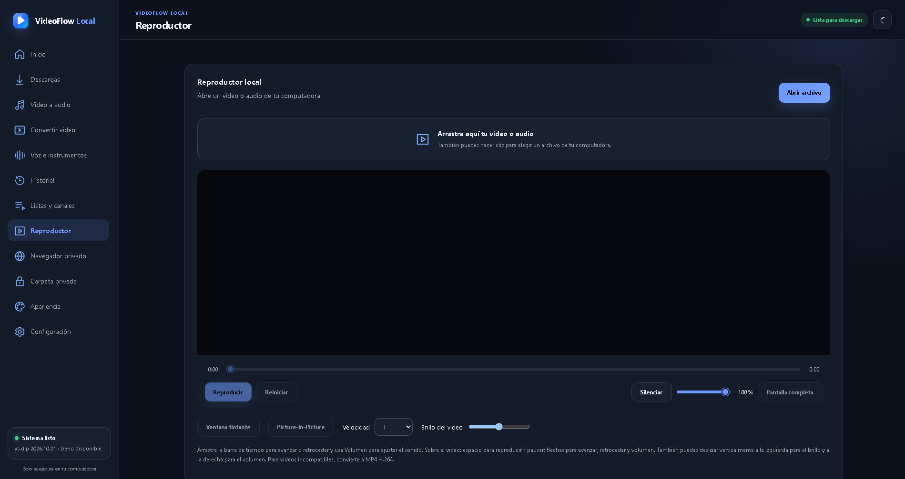

## 08. Navegador privado

Pantalla para abrir una dirección en una **ventana privada de VideoFlow** y consultar después los recursos multimedia detectados. Permite elegir formato y destino, actualizar la detección y borrar la lista de la sesión. La captura está esperando una dirección y muestra **cero recursos detectados y cero solicitudes bloqueadas**. La interfaz explica que el bloqueo por dominios es básico y que algunos sitios o recursos protegidos no se pueden descargar.

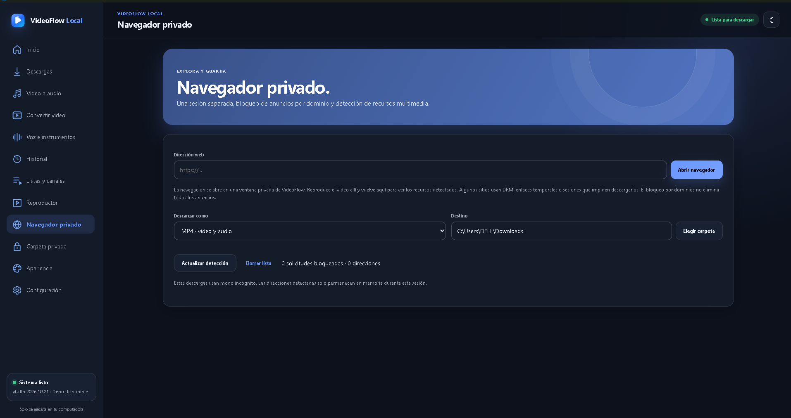

## 09. Carpeta privada

Vista de acceso a las **copias cifradas de archivos**, protegidas mediante un PIN de al menos seis dígitos. La carpeta aparece bloqueada y el campo del PIN está vacío. La pantalla informa del bloqueo automático tras cinco minutos sin uso o al ocultar la aplicación, y aclara que esta versión utiliza PIN.

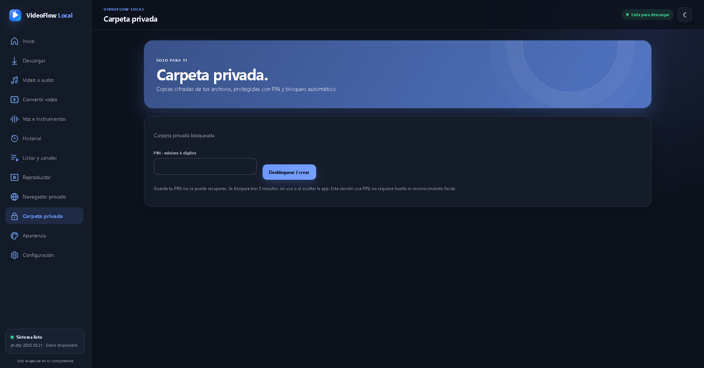

## 10. Apariencia

Panel para personalizar el **modo automático, claro u oscuro**, el tema visual y el color de acento, con una vista previa de la interfaz. La captura utiliza **modo oscuro, tema VideoFlow y acento azul**. También muestra los seis temas disponibles —VideoFlow, Grafito, Océano, Bosque, Ciruela y Arena— y el botón para restablecer la apariencia; las preferencias se guardan en el equipo.

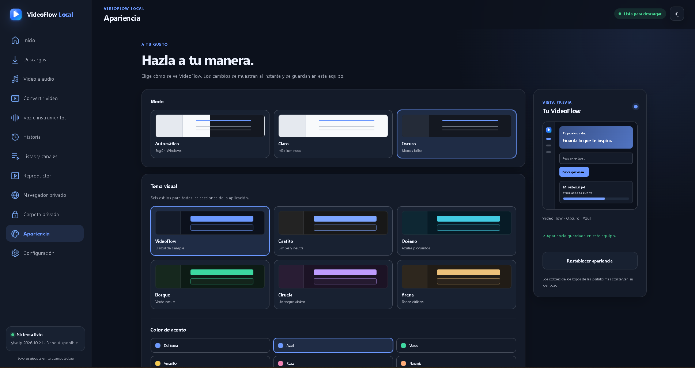

## 11. Configuración

Ajustes para guardar un **destino independiente por plataforma**, definir formato y calidad predeterminados y establecer la cantidad de trabajos simultáneos. En la imagen hay **tres trabajos simultáneos configurados**, con las opciones de continuar en la bandeja y evitar la suspensión automática activadas. También se muestran los controles de velocidad y reintentos, y la comprobación de FFmpeg: **9.0.2 instalada y 9.0.2 como última versión en el momento de la captura**.

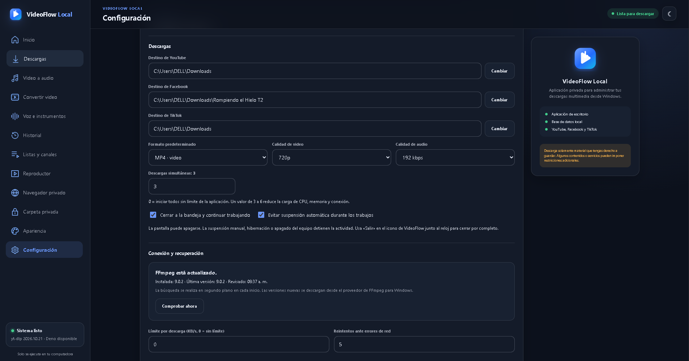

---

[Volver al README](../README.md#capturas-de-pantalla)
